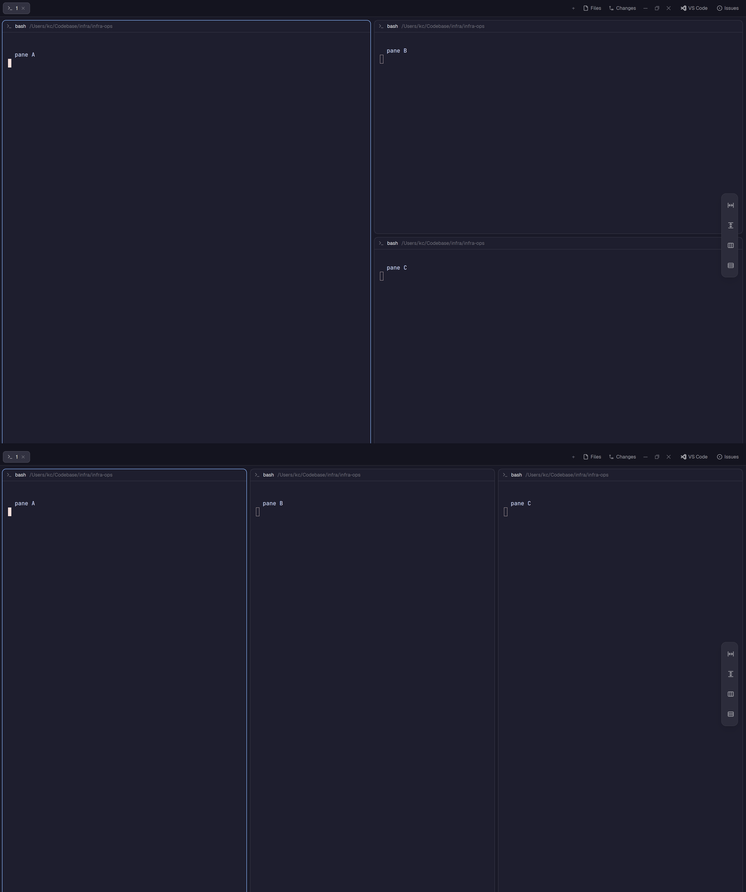

# Pane equalize for Herdr

Even out the panes of the shown tab in the [Herdr app](https://herdr.dev). One key gives every pane in a row the same width. Another key gives every pane in a column the same height. A small drawer on the right edge does the same with a click.



Herdr has no pane resize command yet. A Python script edits the tab's split tree in herdr-core directly. See [RECIPE.md](RECIPE.md) for how it works and its limits.

## Before you install

- This mod runs a program: `python3` (`python` on Windows) runs `equalize.py`, and the script runs `hc`.
- It writes to herdr-core's `herdr-app` document. That document is not documented. The script stops when it sees a shape it does not know.
- It does not reach the network. It reads no files outside the Herdr app folder.
- Tested on Herdr 0.1.12. You need Python 3.

## Install with an agent

Open a coding agent inside Herdr and paste this prompt:

```text
Add the Herdr mods from https://github.com/kcchien/herdr-pane-equalize to my Herdr app.
Read RECIPE.md and every file first. Then:
1. Copy the three folders in mods/ into the mods/ folder of my Herdr app home. Do not overwrite a folder that already exists: ask me first.
2. Merge the "global" keys from keys.json into my keys.json. Ask before you replace a key I already use. On Linux or Windows, ask me which keys to use instead of cmd-alt-=.
3. Add the floating drawer from RECIPE.md ("Built from") to the node that holds { "tab": "active" } in the layout I use now. If that layout is one Herdr ships, clone it first with layout.clone and edit the clone.
4. Run herdr-app check on each of the three mod folders and fix any error.
5. Split a tab into uneven panes and run the width key. Tell me what you see.
```

## Install by hand

The Herdr app home is `~/.config/herdr-app` on macOS and Linux, and `%USERPROFILE%\.config\herdr-app` on Windows.

1. Copy the mods:

   ```sh
   git clone https://github.com/kcchien/herdr-pane-equalize
   cp -R herdr-pane-equalize/mods/pane-equalize-* ~/.config/herdr-app/mods/
   ```

2. Add the keys to `~/.config/herdr-app/keys.json`, in the `global` section:

   ```json
   "cmd-alt-=": "mod.open:pane-equalize-width",
   "cmd-alt-shift-=": "mod.open:pane-equalize-height"
   ```

   These are macOS keys. On Linux and Windows, pick your own.

3. Optional: add the drawer. Shipped layouts are read-only, so clone yours first:

   ```sh
   herdr-app do layout.clone '{"name":"main","as":"my-main"}'
   ```

   In `layouts/my-main.json`, find the node with `"content": { "tab": "active" }`. Add this to its `floating` list (create the list if it is missing):

   ```json
   { "id": "pane-equalize", "content": { "mod": "pane-equalize-bar" },
     "edge": "right", "align": "center", "peek": 40 }
   ```

4. Check each mod:

   ```sh
   for m in width height bar; do herdr-app check ~/.config/herdr-app/mods/pane-equalize-$m; done
   ```

5. Test: split a tab right, then split the right pane right again. Press `cmd-alt-=`. The three panes get the same width.

## Remove

Delete the three `mods/pane-equalize-*` folders, the two keys, and the drawer entry in your layout.

## Files

| Path | What it is |
|---|---|
| `mods/pane-equalize-width/` | The width key's mod, and `equalize.py` |
| `mods/pane-equalize-height/` | The height key's mod. It runs the script from the width folder |
| `mods/pane-equalize-bar/` | The floating drawer and its icons |
| `keys.json` | The macOS keys |
| `tests/test_equalize.py` | Tests for the tree math: `python3 tests/test_equalize.py` |
| `RECIPE.md` | The brief to build it from scratch |
