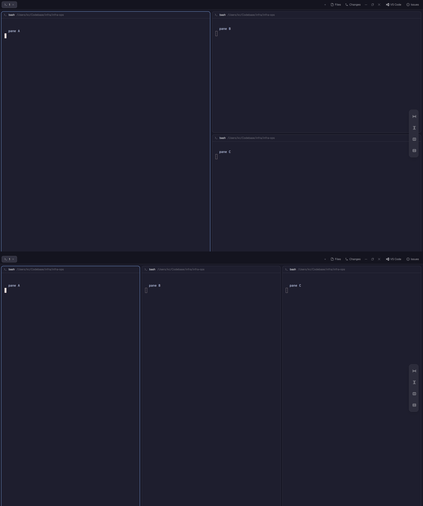

# Pane equalize

Four keys and a small drawer that even out the panes of the shown tab. Press one key and every pane in a row gets the same width. Press another key and every pane in a column gets the same height. Two more keys put every pane of the tab in one row or one column, at equal sizes. Herdr has no pane resize command, so a Python script edits the tab's split tree in herdr-core directly.



The preview shows one tab before (top: pane A on the left, B over C on the right) and after "All side by side" (bottom: A, B and C at 1/3 each). The drawer is the small strip at the right edge, with its four icons.

## What you see

- **Drawer**, a floating block on the right edge of the tab area, vertically centered. It peeks 40 px: only four icons show (16 px, theme `muted`). On hover it slides out and shows four rows:
  - "Even widths" with the key `⌘⌥=` under it.
  - "Even heights" with the key `⌘⌥⇧=` under it.
  - "All side by side" with the key `⌘⌥\` under it.
  - "All stacked" with the key `⌘⌥-` under it.
  - Each row: 9 px side padding, 6 px top and bottom padding, 6 px radius, at least 18 px between icon and text. The icon sits at the edge side of its row, whatever the label length. Label 12 px in theme `foreground`, key 10 px in theme `muted`. Hover paints theme `hover`.
- **Keys**: `cmd-alt-=` evens widths, `cmd-alt-shift-=` evens heights, `cmd-alt-\` puts all panes side by side, `cmd-alt--` stacks all panes.
- Nothing else shows on success. The panes resize in place.
- **Error**: a toast "Equalize panes failed" with the script's last error line.

## How it behaves

- The work is the same for the key and the drawer: both run `mod.open` on `pane-equalize-width`, `-height`, `-row` or `-column`.
- That mod opens as a 1×1 popup. It runs the script on the focused tab, then closes itself when the script ends.
- **Widths:** each row in the tab gives each child a weight equal to its share of leaf panes along the row. A row with panes A | (B | C) gets A = 1/3 and (B | C) = 2/3, so A, B and C end up equal.
- **Heights:** the same for columns.
- **All side by side / All stacked:** every pane of the tab moves into one row (or one column), each with weight 1/n. The order is the split tree's order: left before right, top before bottom. A 2×2 grid of two columns gives top left, bottom left, top right, bottom right.
- Nested splits work. A pane that sits in both a row and a column changes only along the chosen axis.
- A tab that is already even is left alone.
- A tab on another machine works: the script passes that machine to herdr-core.
- Agent status (working, blocked, done, idle) does not matter. The script changes the layout only, never a terminal.

## Built from

- Mods:
  - `pane-equalize-width`: holds `equalize.py`. `mod.json`: `{ "place": "none", "overlay": { "kind": "popup", "width": 1, "height": 1 } }`.
  - `pane-equalize-height`, `pane-equalize-row`, `pane-equalize-column`: the same code with `AXIS = "height"`, `"row"` or `"column"`. They run the script from `mods/pane-equalize-width/`.
  - `pane-equalize-bar`: the drawer, with `width.svg`, `height.svg`, `row.svg` and `column.svg`. `mod.json`: `{ "place": "none" }`.
- Layout: add this to the `floating` list of the node that holds the tab (`{ "tab": "active" }`) in your own layout or a clone (`herdr-app do layout.clone '{"name":"main","as":"my-main"}'`):

  ```json
  { "id": "pane-equalize", "content": { "mod": "pane-equalize-bar" },
    "edge": "right", "align": "center", "peek": 40 }
  ```

- `keys.json`: merge its `global` section into yours.
- `herdr` functions: `focused()`, `spaces()` (the space's `machine`), `exec()`, `appHome()`, `notify()`, `props()`, `closeOverlay()`, `placement()`, `run()`, `theme()`, `window().platform`.
- Programs: `python3` (`python` on Windows) runs `equalize.py`. The script runs `hc connect --json` and sends `doc.get` and `doc.set` for the `herdr-app` document.
- Tests: `python3 tests/test_equalize.py` checks the tree math. It never touches a live document.

## Watch out

- The `herdr-app` document in herdr-core is not documented. The script refuses to write when it sees a node type other than `row`, `column` or `block`, or a child size other than `{ "weight": n }`. It prints the old tree to stderr before it writes, so you can restore it by hand.
- The write uses the document version. If the app changes the document at the same moment, the script reads again and tries once more.
- Do not close the popup before `exec` ends. Closing the overlay ends the mod copy and cancels its work, and the edit can get lost.
- On Windows, `python3` is often the Microsoft Store alias, not a real Python. The mods use `python` there.
- The keys are macOS keys. On Linux and Windows, pick your own.
- Mods cannot import from other mod folders, so the four key mods repeat the same code. Keep them in step.
- The app shows a tab on another machine as `<machine>/<id>`. That machine's document stores only `<id>`. The script drops the prefix before it looks for the tab.
- Rows in the drawer have labels of different widths. Without `justify_between` on each row, the icons of short rows move out of the 40 px peek strip.
- Tested on Herdr 0.1.13. A future version may add a resize command or change the document.

## Done when

- `herdr-app check` passes for all five mod folders.
- `python3 tests/test_equalize.py` passes.
- Split a tab right, then split the right pane right again. The widths are 1/2, 1/4, 1/4. Press `cmd-alt-=`. All three panes get the same width.
- Run it again on the same tab. Nothing changes.
- Split a pane down twice and press `cmd-alt-shift-=`. The panes in that column get the same height. The widths stay as they were.
- Make a 2×2 grid and press `cmd-alt-\`. The four panes go side by side at equal widths. Press `cmd-alt--`. They stack at equal heights.
- On a space on another machine, press `cmd-alt-=`. It works there too.
- The drawer peeks with all four icons in line at the edge. Hover it. It slides out with four rows. Clicking a row does the same as its key.
